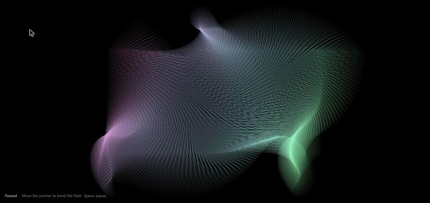

# Flow Field: Canvas 2D

An animated flow field of about 10,000 thin gradient lines, drawn with the HTML Canvas 2D API in TypeScript. There are no libraries.

**Live demo:** https://samvel97.github.io/canvas---abstraction/



## How it works

The field is a grid with one cell every 5 px. Each cell draws a 150 px line at the angle

```
angle = (cos(x · 0.01 + φx) + sin(y · 0.01 + φy)) · r
```

- `r` oscillates between 0 and 5 radians over time, which animates the pattern
- `φx`, `φy` are a phase shift driven by the pointer, eased so the field follows the cursor smoothly
- The lines are stroked with a diagonal linear gradient at 0.09 px width, so overlapping lines build up brightness

## Performance

All lines are added to **one path with a single `stroke()` call** per frame. Measured in Chrome at
1440×681 on a 120 Hz display:

| Approach | Frame rate |
|---|---|
| `beginPath()` + `stroke()` per line (original) | ~35 fps |
| one path, one `stroke()` | ~118 fps (display cap) |

The rendered pixels are practically identical. With batching, it holds ~120 fps even at `devicePixelRatio` 2
(2880×1362 backing store).

## Features

- Pointer (mouse, pen or touch) bends the field
- **Space** pauses; starts paused when the OS "reduce motion" setting is on
- Elapsed-time animation, so the speed is the same at 60, 120 and 144 Hz
- Sharp on HiDPI screens; adapts to window resize

## Run locally

```bash
npm install
npm run dev      # development server
npm run build    # type-check and build to dist/
```
